# QA Automation Intelligence

> **What & why:** a desktop dashboard (Python + Tkinter) that turns automated test results into quality signals, so you can see *where* quality is slipping and *what to look at first* instead of reading raw pass/fail lists.

It covers:

- pass-rate trends, failure pressure and momentum
- execution-time and latency volatility
- anomalies and regression / recovery events
- regression risk per feature
- coverage gaps, with explained recommendations

Results come from a Playwright suite that checks https://www.qa-practice.com, a practice site of UI elements (inputs, buttons, checkboxes, selects, dialogs, drag-and-drop, iframes, new tabs, pop-ups) plus a practice form and a contact form. Each run is written to PostgreSQL, and the dashboard refreshes on its own when a new run lands.

```
pytest + Playwright ──► PostgreSQL (schema: live) ──► analytics engine ──► Tkinter dashboard
                         PostgreSQL (schema: demo)  ◄── synthetic 90-day history
```

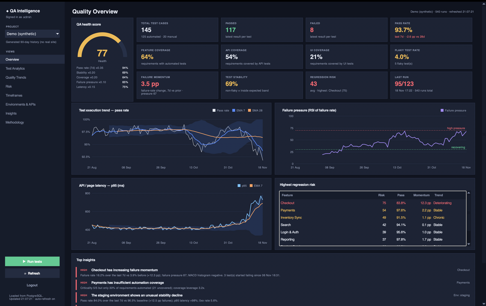

## Setup

> **What & why:** install Python packages, a Chromium browser for Playwright, and point the app at a PostgreSQL database, because every result the dashboard shows is read from there.

Requirements: Python 3.11+ with Tk, and PostgreSQL 13+ (a Docker container is fine).

```bash
python -m venv .venv && source .venv/bin/activate
pip install -r requirements.txt
python -m playwright install chromium
```

Create a `.env` file in the project root (it is git-ignored, so the password never ends up in the repo):

```
QA_DB_HOST=localhost
QA_DB_PORT=5432
QA_DB_NAME=qa_intelligence
QA_DB_USER=qa_app
QA_DB_PASSWORD=<password>
```

The database and role must exist. For example, as the Postgres superuser:

```sql
CREATE ROLE qa_app LOGIN PASSWORD '<password>';
CREATE DATABASE qa_intelligence OWNER qa_app;
```

Then create the schemas, load the demo project, and add a dashboard login:

```bash
python seed.py                                  # creates schemas live + demo, loads demo history
python manage_users.py add admin --name "Admin" # prompts for a password (min 8 chars)
```

## Database (PostgreSQL)

> **What & why:** PostgreSQL is the single store between the test suite and the dashboard. Tests write results to it and the dashboard reads them back, so runs from a terminal, CI or the **Run tests** button all end up in the same history.

**Why PostgreSQL:** it keeps the full run history safely across sessions, several writers (CI, a laptop) can record at the same time, and the `psycopg2` driver uses the same `connect / execute / commit` style as the MySQL examples in the course PDFs.

**How it is organised:** one database, `qa_intelligence`, with one schema per project. Each project schema has the same tables, so the dashboard code doesn't care which project it reads.

| Schema | What it holds | Written by |
|---|---|---|
| `live` | Real Playwright runs against `QA_BASE_URL` (now qa-practice.com), one row per run | `db/recorder.py` at the end of every `pytest tests/e2e` session |
| `demo` | 90 days of synthetic history with planted problems, so every chart has data | `seed.py` (or *File → Regenerate demo data…*) |
| `live_archive_<timestamp>` | Earlier live history kept aside after the site under test changed | `seed.py --archive-live` |
| `public` | `app_users`: dashboard logins (PBKDF2 password hash, salt, failed attempts, lock time) | `manage_users.py` |

**How data flows:**

1. **Write:** when a test session ends, the recorder upserts the catalog (features, requirements, use cases, test cases, endpoints), then inserts one `test_runs` row, one `test_results` row per test and one `api_metrics` row per timed request, all in a single transaction. Because the catalog is upserted, adding a test needs no database change.
2. **Read:** the dashboard loads every table of the selected schema into pandas DataFrames (`db/repository.py → load_all`), and the analytics engine works on those.
3. **Watch:** every 15 s the dashboard runs a cheap `MAX(id), COUNT(*)` query on `test_runs`. If it has changed, a new run has landed and the dashboard reloads.

**Tables** (identical in every project schema):

```
features ─┬─< test_cases ─< test_results >─ test_runs >─ environments
          ├─< requirements ─< use_case_steps >─ use_cases
          ├─< api_endpoints ─< api_metrics >─ environments
          └─< code_changes
public.app_users   (dashboard logins)
```

| Table | One row is… | Used for |
|---|---|---|
| `features` | a feature of the site, with criticality 1–5 | grouping, risk weighting |
| `requirements` | one requirement of a feature | coverage |
| `use_cases`, `use_case_steps` | a user journey and its ordered requirement steps | use-case coverage |
| `test_cases` | a test (automated or manual, UI or API) linked to a requirement | suite size, coverage gaps |
| `environments` | where a run happened (`production`, `staging`, …) | environment stability |
| `test_runs` | one pytest session: start time, build number, wall-clock duration | the time axis (one bar per run) |
| `test_results` | one test's outcome in one run: status, duration, failure message | pass rate, failures, flakiness |
| `api_endpoints`, `api_metrics` | a request path / page, and each timing with its status code | latency, p95, spread |
| `code_changes` | lines changed per feature (demo only) | change-volume part of the risk score |

The table definitions live in `db/schema.sql`. It uses only `CREATE … IF NOT EXISTS`, so it is safe to run again on an existing database.

## Running

> **What & why:** one command for each job: open the dashboard, run the site tests (recorded or not), check the engine, or reset data.

| Task | Command |
|---|---|
| Dashboard | `python main.py` |
| Site tests (recorded) | `pytest tests/e2e` |
| Site tests, not recorded | `QA_RECORD=0 pytest tests/e2e` |
| Engine unit tests | `pytest tests/unit` |
| Suite analysis in the terminal | `python analyze.py` (`--project demo`, `--window 30`, `--csv out/`) |
| Reset demo data | `python seed.py --seed 7` |
| Start a fresh live history (after changing the site under test) | `python seed.py --archive-live` |

`--archive-live` renames the `live` schema to `live_archive_<timestamp>` and creates an empty one. Nothing is deleted; the old runs stay queryable in the archive schema.

### Login

> **What & why:** the dashboard opens on a login screen so only known users can see the quality data. The status line under the button confirms that the database connection works before you sign in.

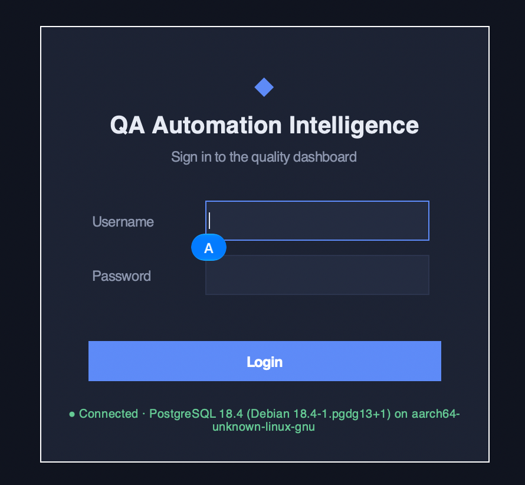

Credentials are checked against `public.app_users`:

- Passwords are stored as PBKDF2-SHA256 with a per-user salt.
- A failed login always shows the same generic error.
- An account locks for 60 s after 5 failed attempts.

### Sidebar and projects

> **What & why:** the sidebar is where you choose *which data* to look at (project) and *which view*, and where you start a test run without leaving the app.

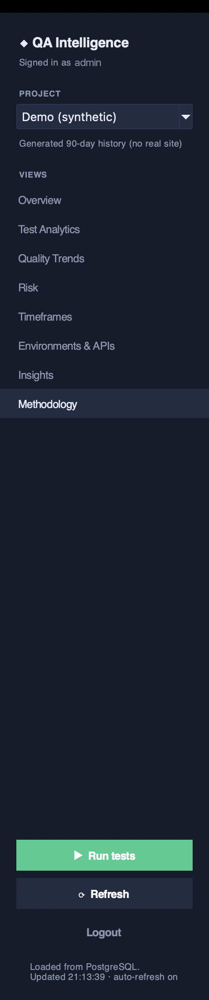

After login, the sidebar has the views, a **project switcher**, **Run tests** and **Refresh**:

- **qa-practice.com (live)**: real Playwright runs, one bar per run. The label follows `QA_BASE_URL`, and the site under test is shown under the switcher.
- **Demo (synthetic)**: 90 days of generated history with planted regressions, flaky tests, volatility, an unstable environment and a recovery. It shows every indicator with enough history behind it.

**Run tests** runs the suite in a log window and refreshes when it finishes. The dashboard also polls the database every 15 s, so runs started from a terminal or CI appear without a manual refresh.

<br clear="right">

## Views

> **What & why:** each view answers one question about quality. The screenshots below show the **Demo (synthetic)** project, because its 90-day history fills every chart.

| View | Question it answers |
|---|---|
| [Overview](#overview) | How healthy is the suite right now? |
| [Test Analytics](#test-analytics) | What do we cover, and which tests fail or slow us down? |
| [Quality Trends](#quality-trends) | Is quality getting better or worse, and since when? |
| [Risk](#risk) | Which feature should we test first? |
| [Timeframes](#timeframes) | Is a dip a short blip or a chronic problem? |
| [Environments & APIs](#environments--apis) | Is it the code, or the environment / a slow endpoint? |
| [Insights](#insights) | What should we do about it? |
| [Methodology](#methodology) | How is each number calculated? |

### Overview

> **What & why:** one screen with the health score and the key numbers, so you can see at a glance whether anything needs attention.

Health score (with its components), test counts, pass rate, feature / API / UI coverage, flaky rate, failure momentum, stability, regression risk, last run; trend, failure-pressure and latency charts; top risks and insights.


### Test Analytics

> **What & why:** shows what the suite actually covers (requirements, use cases, features) and where test time and failures go, so you know which gaps to fill and which tests to fix.

Use-case coverage, feature coverage, requirement coverage, test suite size and growth, run duration (trend and time per feature), execution status per week / run, top failures with streaks, failure reasons, slowest tests, flaky tests; selectable analysis window.

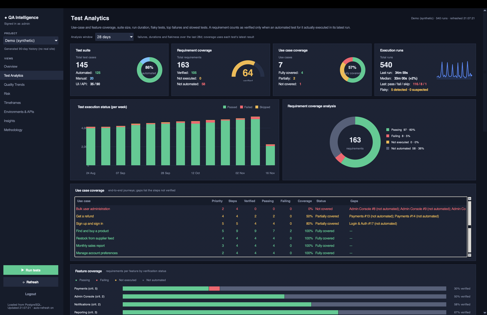
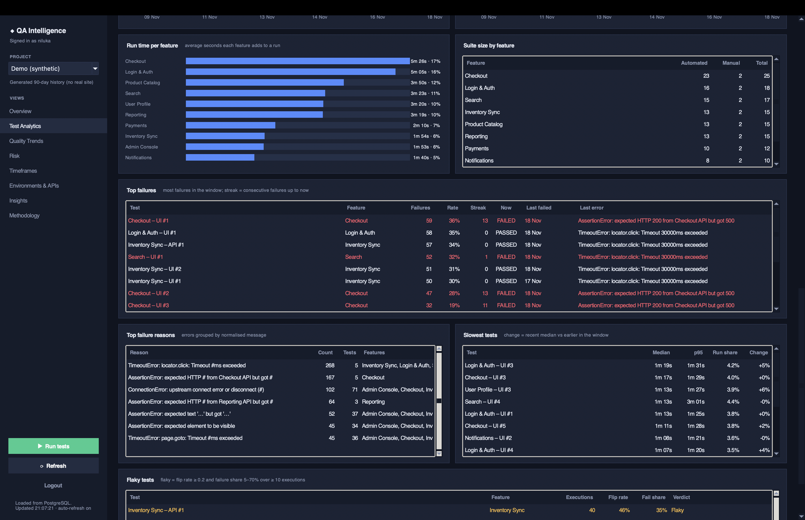
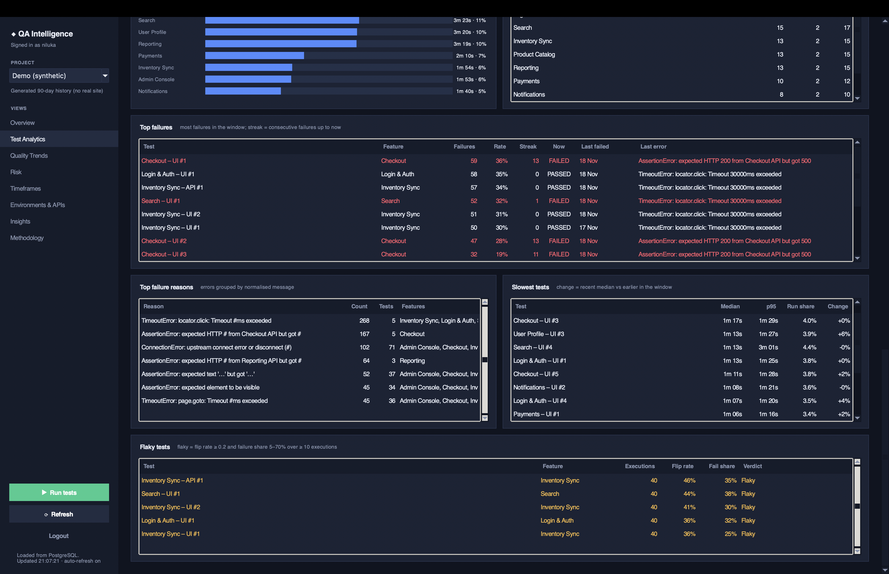

### Quality Trends

> **What & why:** follows one signal over time against its own normal range, so a slow decline is caught early instead of after it becomes an outage.

Any signal (pass rate, failure rate, suite duration, latency) for any feature / environment: short-term trend vs baseline, normal range, quality momentum, failure / slowdown / latency pressure index, change over time, detected events (regression detected, recovered, unusual result).

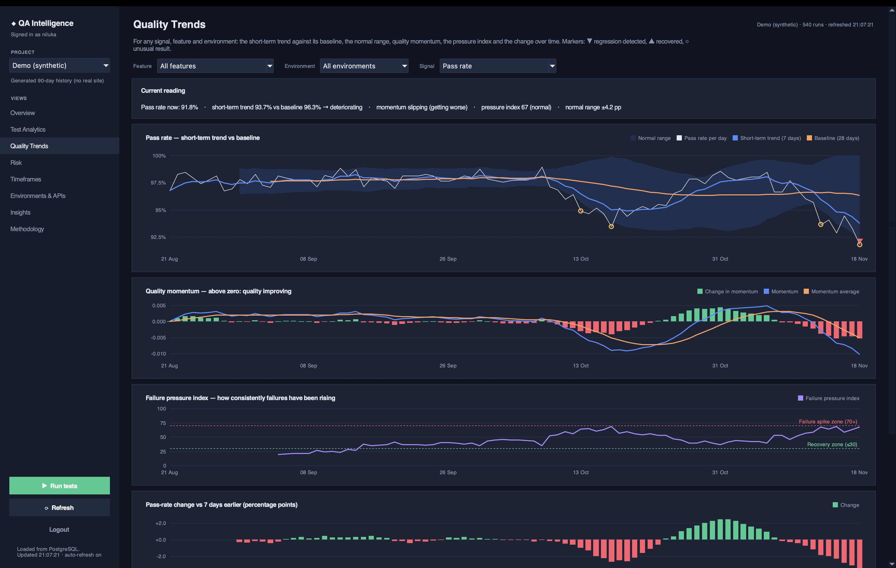
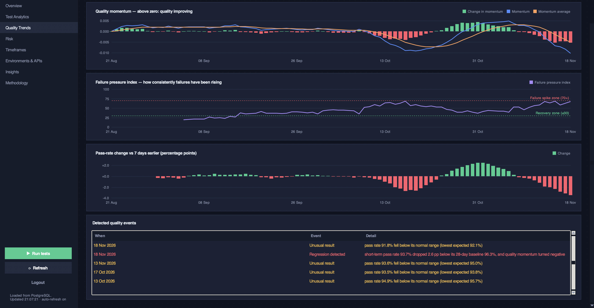

### Risk

> **What & why:** ranks features by regression risk and shows the evidence behind each score, so limited test time goes to where it matters most.

Features ranked by regression risk, per-component breakdown, quality gate, evidence, and a risk-proportional test-budget allocator.

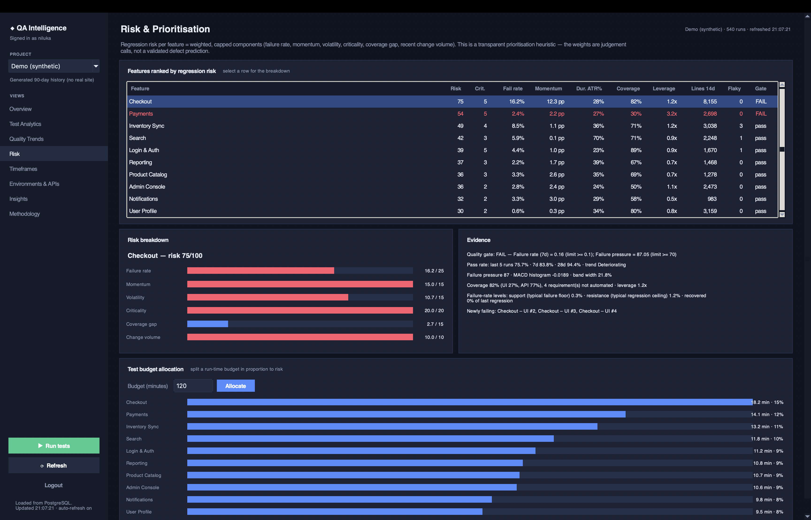

### Timeframes

> **What & why:** compares the same signal over short and long windows, to tell a one-off dip from a problem that has been building for weeks.

Pass rate over last 5 runs / 7 / 28 / 90 bars with classification (stable, short-term dip, deteriorating, chronic, improving); OHLC candles and ATR of duration or latency.

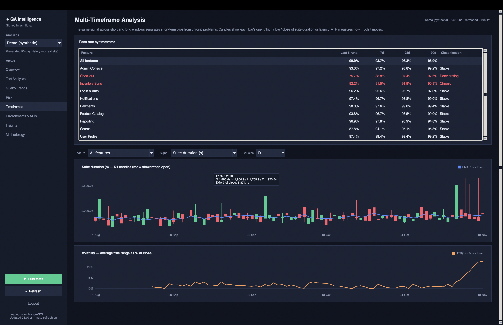

### Environments & APIs

> **What & why:** separates environment problems from code problems, and finds pages or endpoints that are getting slower before users notice.

Environment stability, latency per endpoint/page (p50, p95, spread, baseline, alert ladder, errors).

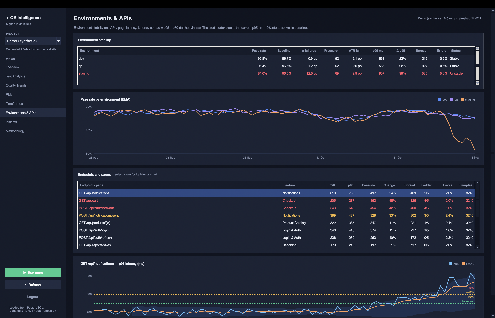

### Insights

> **What & why:** turns the numbers into a short to-do list. Every finding states its evidence and a recommended action. Export it to CSV from the File menu.

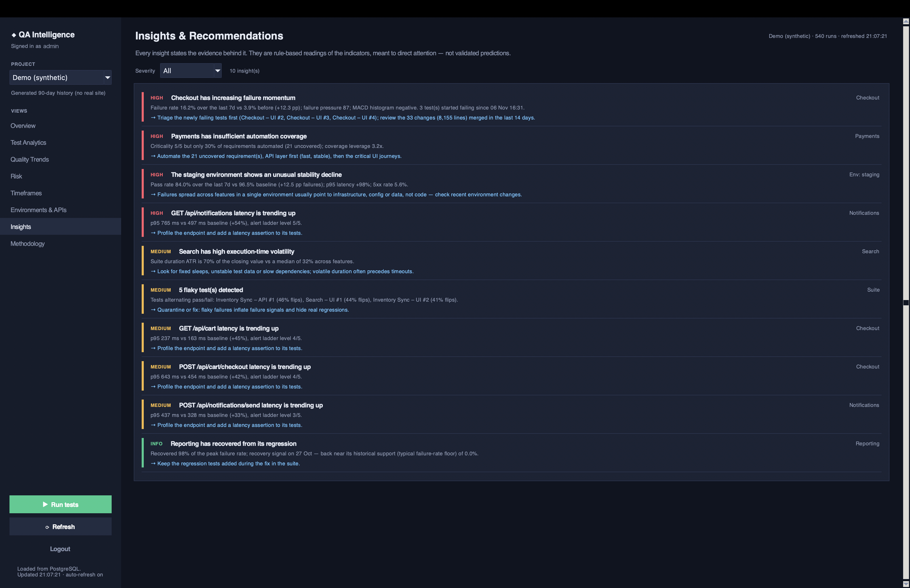

### Methodology

> **What & why:** documents how every number on the dashboard is calculated, so nothing on screen is a black box.

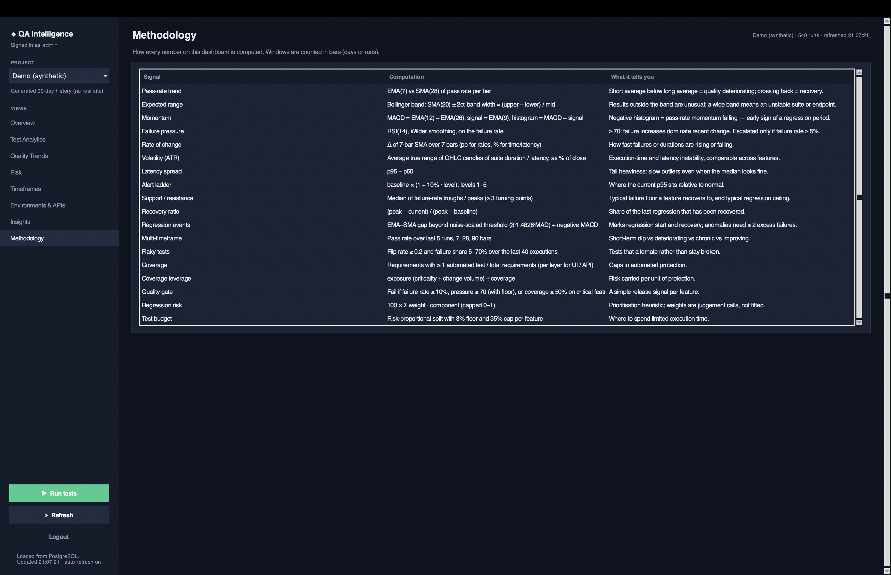

## Test suite (`tests/e2e`)

> **What & why:** real browser and HTTP checks of qa-practice.com. They produce the live data the dashboard analyses, and each test is mapped to a requirement so coverage can be measured.

The suite has two layers:

- **API layer**: Playwright's HTTP client (`APIRequestContext`), for fast checks of status codes, headers and page content.
- **UI layer**: a real Chromium page, for anything a user clicks, types or sees.

Every test is tagged with the requirement it covers:

```python
@pytest.mark.qa("Home page", 2, "API")   # feature, requirement no., layer
def test_home_response_time_budget(api): ...
```

`tests/e2e/catalog.py` defines:

- **`FEATURES`**: each feature's criticality and its requirements. Requirements marked `automated=False` are deliberate gaps and lower the coverage figures: sending the contact form (it would message the real site owner), the date picker, picture upload and image drag-and-drop.
- **`USE_CASES`**: end-to-end learner journeys (e.g. *Complete the practice form*, *Handle browser dialogs and pop-ups*), each listed as steps that point to requirements, possibly across features.

| Feature | File | Checks |
|---|---|---|
| Home page | `test_home.py` | 200 over HTTPS with the QA Practice title, 3 s response budget, heading + sidebar + footer render, no JS errors, no horizontal scroll at 390 px |
| Navigation | `test_navigation.py` | sidebar groups list every section, every menu link resolves, click-through to the practice form, unknown paths return 404 |
| Inputs & text areas | `test_elements.py` | text input echo and validation (invalid characters, too short), email validation, password field, single and multiple text areas |
| Buttons | `test_elements.py` | simple button, link-styled button, disabled button enabled from its select |
| Checkboxes & selects | `test_elements.py` | single and multiple checkboxes, single select, three chained selects |
| Alerts & pop-ups | `test_interactions.py` | alert message, confirm OK / Cancel, prompt echo, modal opens, submits and closes |
| Frames, tabs & drag-and-drop | `test_interactions.py` | iframe content, link opening a new tab, box dragged onto the drop zone |
| Practice form | `test_forms.py` | page with a CSRF-protected form, valid submit shows the results modal, empty submit blocked, state → city cascade, subjects autocomplete |
| Contact form | `test_forms.py` | page has a form; message is required (checked without sending) |
| SEO & crawlability | `test_seo_and_security.py` | robots.txt rules, valid sitemap (sitemap index followed), sitemap URLs on the canonical https host |
| Security headers | `test_seo_and_security.py` | http → https permanent redirect, HSTS ≥ 180 days, nosniff + frame protection |

Element pages post their form back to the site and re-render with the submitted value in `#result-text`, which is what the tests assert. In the browser, Google Analytics / Tag Manager requests are blocked so test runs don't count as site visits.

Known failures against the live site (as of 2026-11-18): every page throws `handleToggleNavProfile is not defined` on load, `/robots.txt` returns 404, and no HSTS header is sent. These are site defects, not test problems.

Fixtures:

- `api` times every request.
- `site(path)` opens a page in the browser and records its load time.

Both kinds of timing feed the latency charts. At the end of the session, `db/recorder.py` writes one run to the `live` schema (see [Database](#database-postgresql)).

### Bot protection

> **What & why:** if the site ever serves a "verify you are human" page, tests are skipped with a clear reason instead of failing, so a blocked browser isn't mistaken for a broken site.

qa-practice.com is served through Cloudflare but currently lets headless Chromium through. If a bot challenge is ever served instead of the site (or `QA_BASE_URL` points at a protected host):

- The test is recorded as **SKIPPED** with that reason, not as FAILED.
- The dashboard raises a high-severity "UI tests blocked by bot protection" insight.

Fixing this properly needs a change on the site side: allowlist the test runner (e.g. a WAF skip rule for the CI egress IP or a secret header), or point `QA_BASE_URL` at an unprotected staging host. The suite does not try to evade the challenge.

### Configuration

> **What & why:** environment variables let the same suite target another site, label the environment, or run without recording, with no code changes.

| Variable | Default | Purpose |
|---|---|---|
| `QA_BASE_URL` | `https://www.qa-practice.com` | Site under test (default set in `config.py`; can also go in `.env`) |
| `QA_ENV_NAME` | `production` | Environment label stored with the run |
| `QA_RECORD` | `1` | `0` disables writing results |
| `BUILD_NUMBER` | previous + 1 | CI build number |

CI example: run `pytest tests/e2e` on a schedule (e.g. hourly) with the `QA_DB_*` variables set. Each run becomes one more bar on the dashboard.

## Analytics engine (`engine/`)

> **What & why:** applies well-known time-series indicators (moving averages, RSI, MACD, Bollinger bands, ATR) to test results. These spot trends and unusual results more reliably than eyeballing a pass rate.

Time is measured in **bars**: one per run for the live project, one per day for the demo. All windows are counted in bars.

| Signal | Computation |
|---|---|
| Trend | EMA(7) vs SMA(28) of pass rate |
| Expected range | SMA(20) ± 2σ band; band width = instability |
| Momentum | MACD 12/26/9 on pass rate |
| Failure pressure | RSI(14) of failure rate; escalated only when failure rate ≥ 5% |
| Volatility | ATR of per-bar OHLC candles of suite duration / latency, as % of close |
| Latency | p50, p95, spread (p95 − p50), +10% alert ladder over a baseline |
| Events | Regression start / recovery when the EMA–SMA gap exceeds a noise-scaled threshold (3 × robust σ) with negative MACD; anomalies need ≥ 2 excess failures |
| Levels | Support / resistance of failure rate (median troughs / peaks), recovery ratio of the last regression |
| Flakiness | Flip rate ≥ 0.2 and failure share 5–70% over the last 40 executions |
| Attribution | Failures concentrated in one environment are reported as environmental; endpoint trends use the median across environments |
| Risk | 100 × Σ weight × component: failure rate .25, momentum .15, volatility .15, criticality .20, coverage gap .15, change volume .10 |

The risk score and insights are a transparent prioritisation aid. The weights and thresholds (`config.py`) are judgement calls, not fitted or validated predictions. Trend indicators need roughly 10+ bars of history; until then the dashboard says so and relies on current failures, coverage and latency. `MAPPING.md` explains how each indicator was adapted from forex trading to QA.

## Test-suite analysis (`engine/suite.py`)

> **What & why:** looks at the suite itself (coverage, failures, slow and flaky tests), so you can improve the tests, not just read their results.

Each requirement gets a status from the latest result of its automated tests:

- **Passing**: the tests ran and passed.
- **Failing**: at least one ran and failed.
- **Not executed**: automated, but skipped or blocked.
- **Not automated**: no automated test covers it.

A requirement is **verified** when it is Passing or Failing.

| Analysis | Definition |
|---|---|
| Use-case coverage | Verified steps ÷ steps. *Fully covered*: every step verified. *Partially covered*: some steps. *Not covered*: none. Health (passing / failing) is reported separately, and unverified steps are listed as gaps. |
| Feature coverage | Requirements per feature by status; automated %, verified %, passing % |
| Suite size | Test cases (automated / manual, UI / API, per feature); tests executed per run; tests added in the window |
| Run duration | Wall-clock time per run, trend (median of the last 5 runs vs earlier), median, p95, average seconds each feature adds to a run |
| Top failures | Failures, failure rate, current streak of consecutive failures, status now, last error, per test in the window |
| Failure reasons | Failure messages normalised (numbers and quoted values masked), then grouped: count, tests and features affected |
| Slowest tests | Median and p95 duration, share of total run time, recent median vs earlier in the window |
| Flaky tests | Detected (≥ 10 executions) and *suspected*: alternating results but too few runs to confirm |

The analysis window is set in the view, or with `--window` for `analyze.py`. It is counted in runs for the live project and in days for the demo. Coverage always uses each test's latest result.

## Project layout

> **What & why:** where each part lives, so you know which file to open for a change.

```
main.py              dashboard entry point
analyze.py           test-suite analysis in the terminal / CSV
seed.py              create schemas, load demo data, archive live history
manage_users.py      add users / reset passwords
config.py            DB settings (.env), site under test, analysis parameters
db/                  schema.sql, repository (load/save/archive), recorder (test runs), auth
data/                demo-data generator, project loading
engine/              indicators, time-series helpers, analytics + insights, suite analysis
ui/                  theme, widgets, Canvas charts, login, pages, app shell
tests/e2e/           Playwright suite, catalog, recording plugin
tests/unit/          engine tests
docs/screenshots/    dashboard screenshots used in this README
```
